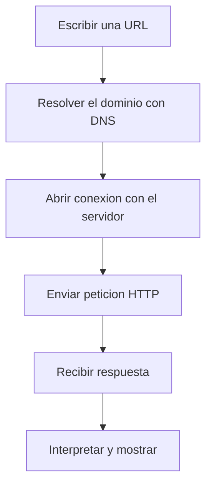
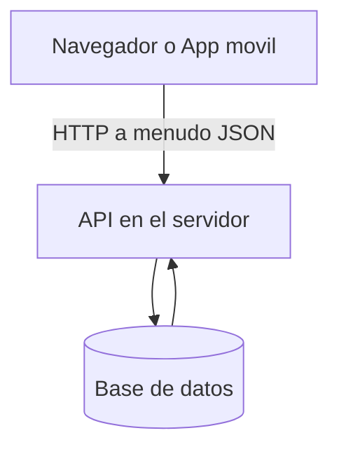
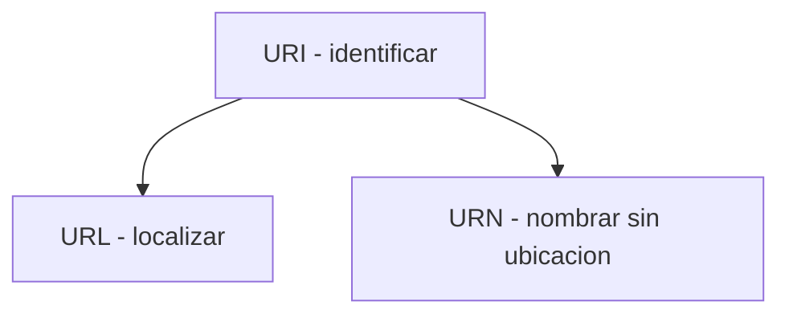
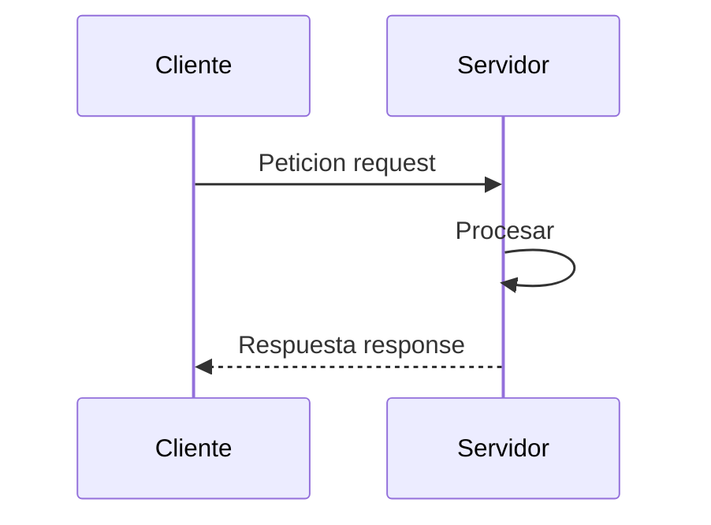
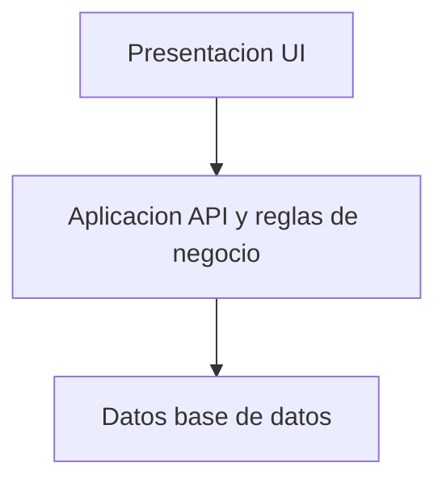
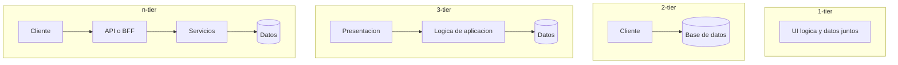

# 01 — Fundamentos web

## 1. Conceptos básicos

La **World Wide Web** es un sistema de recursos (páginas, imágenes, datos, APIs) identificados con direcciones y transferidos principalmente con **HTTP/HTTPS**, sobre Internet.

| Concepto | Definición |
|----------|------------|
| **Internet** | Red global de redes (infraestructura) |
| **Web** | Servicio que corre *sobre* Internet (junto a correo, DNS, etc.) |
| **Frontend** | Capa de interfaz visible (HTML, CSS, JavaScript, React, Vue…) |
| **Backend** | Lógica, seguridad y acceso a datos en el servidor (Node.js, Python, Java, PHP, .NET…) |
| **Base de datos** | Almacenamiento persistente (MongoDB, PostgreSQL, MySQL…) |

- **Página estática**: archivos listos (HTML/CSS/JS) entregados tal cual.
- **Aplicación dinámica**: contenido generado o transformado según usuario, datos y reglas de negocio.

Separación habitual hoy:

Ideas a no confundir:
1. **HTML** estructura contenido; **no** es un lenguaje de programación.
2. JavaScript en el navegador corre en el **cliente**; **Node.js** permite usar JavaScript también en el **servidor**.
3. Una **API** no es la base de datos: es la interfaz para pedir/enviar datos o ejecutar acciones.

---

## 2. URI, URL y URN

| Término | Significado | Idea clave |
|---------|-------------|------------|
| **URI** | *Uniform Resource Identifier* | Identificar un recurso |
| **URL** | *Uniform Resource Locator* | URI que indica **dónde** está y **cómo** acceder |
| **URN** | *Uniform Resource Name* | URI que nombra un recurso **sin** indicar ubicación |

> Toda URL es una URI. Toda URN es una URI. No toda URI es una URL.

En la práctica diaria de la web: trabajar casi siempre con **URLs**.

Ejemplo: `https://www.ejemplo.com:443/tienda/productos?categoria=libros&orden=precio#ofertas`

| Parte | Función |
|-------|---------|
| **Scheme** | Protocolo (`https`, `http`…) |
| **Host** | Dominio o IP (`www.ejemplo.com`) |
| **Puerto** | Por defecto `80` (HTTP) y `443` (HTTPS); a menudo se omite |
| **Path** | Ruta del recurso (`/tienda/productos`) |
| **Query** | Parámetros tras `?` (`categoria=libros&orden=precio`) |
| **Fragment** | Tras `#` (`ofertas`); lo usa el navegador; **no** suele enviarse al servidor |

- **Path** → identificar el recurso: `/productos/42`
- **Query** → filtrar, ordenar o paginar: `/productos?categoria=ropa&page=2`
- URL **absoluta** (`https://ejemplo.com/css/app.css`) vs **relativa** (`/css/app.css`)

---

## 3. Arquitectura cliente-servidor

| Rol | Función |
|-----|---------|
| **Cliente** | Iniciar la comunicación y solicitar un servicio o recurso (navegador, app, script…) |
| **Servidor** | Escuchar peticiones, procesar y responder |

En HTTP clásico: el cliente inicia; cada petición se interpreta por sí sola (*stateless* a nivel de protocolo); a cada petición corresponde una respuesta.

Capas lógicas frecuentes (pueden estar en la misma máquina o en varias):

| Modelo | Idea |
|--------|------|
| Clásico | El navegador pide páginas al servidor |
| SPA + API | App JavaScript en el cliente; datos vía API (JSON) |
| SSR | HTML generado en el servidor |
| BFF (*Backend for Frontend*) | API intermedia adaptada a un tipo de cliente |
| Microservicios | Varios servicios especializados en lugar de un solo monolito |

**Regla básica:** validar siempre en el servidor; no confiar solo en validaciones del cliente.

---

## 4. Arquitectura por capas: 1-tier, 2-tier, 3-tier y n-tier

*Tier* = capa o nivel de la aplicación. Describe **cómo se separan** presentación, lógica y datos (y si viven en la misma máquina o en varias).

| Arquitectura | Qué incluye | Idea simple |
|--------------|-------------|-------------|
| **1-tier** | Todo en un solo lugar | UI + lógica + datos juntos (p. ej. un programa de escritorio con su archivo local) |
| **2-tier** | Cliente + servidor de datos | El cliente habla casi directo con la base de datos |
| **3-tier** | Presentación + lógica + datos | Cliente ↔ servidor de aplicación ↔ base de datos |
| **n-tier** | Tres o más capas | 3-tier ampliado: proxies, APIs, caché, microservicios, colas… |

### Detalle útil para la web

- **1-tier:** poco habitual como “app web moderna”; sirve para entender el extremo “todo junto”.
- **2-tier:** el cliente concentra mucha lógica y se conecta a la BD. Escala y seguridad peores si la BD queda expuesta a muchos clientes.
- **3-tier:** el modelo clásico de muchas apps web:
  1. **Presentación** — navegador / app  
  2. **Lógica** — backend / API  
  3. **Datos** — MongoDB, PostgreSQL, etc.
- **n-tier:** la práctica actual cuando hay más piezas (Nginx, API Gateway, varios servicios, caché Redis, colas…). Sigue siendo cliente-servidor; solo hay **más capas** en el medio.

Relación con lo ya visto: SPA + API + MongoDB es, en esencia, **3-tier**. Microservicios y BFF suelen ser **n-tier**.

Importante: *tier* (despliegue/separación física o de red) no es exactamente lo mismo que *layer* (separación lógica en el código), aunque en la práctica se usan casi como sinónimos al enseñar.

---

## Resumen

Internet ≠ Web. La programación web conecta **cliente**, **servidor** y (casi siempre) **datos** mediante **URLs** y **HTTP**. Las apps se organizan en **1 / 2 / 3 / n-tier** según cuántas capas se separen.

## Autoevaluación

1. Diferenciar Internet y Web; frontend y backend.
2. Determinar si toda URL es URI y si toda URI es URL; indicar qué parte de la URL no suele enviarse al servidor.
3. Explicar quién inicia la comunicación en HTTP; diferenciar 2-tier, 3-tier y n-tier con un ejemplo web.
