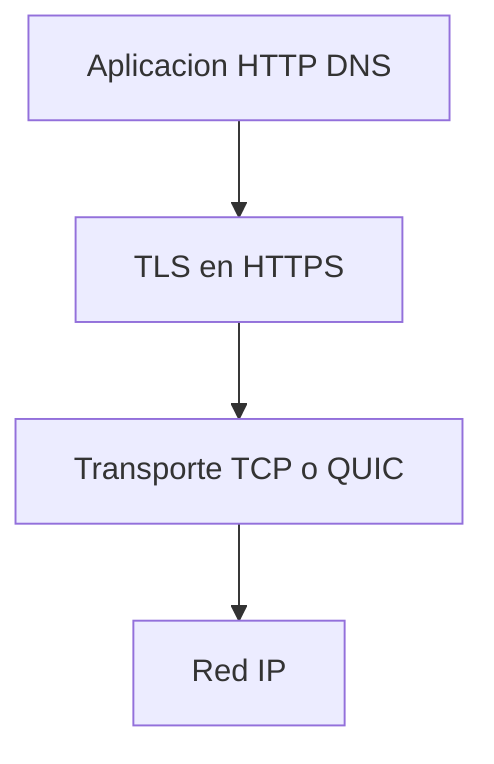
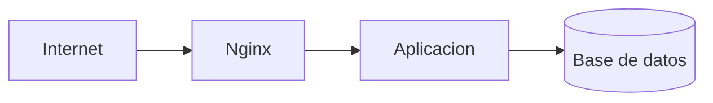

# 02 — HTTP, protocolos y servidores

## 1. Protocolos

Un **protocolo** es un conjunto de reglas para comunicarse. En la web, el principal es **HTTP**; su versión segura es **HTTPS**.

### HTTP

- Protocolo de **aplicación**, modelo **petición–respuesta**.
- **Stateless**: cada petición se entiende por sí sola (sin “memoria” de la anterior a nivel de protocolo).
- Suele viajar sobre **TCP**. **HTTP/3** usa **QUIC** (sobre UDP).

| Versión | Nota práctica |
|---------|----------------|
| HTTP/1.1 | Muy extendida |
| HTTP/2 | Varias peticiones en paralelo sobre una conexión |
| HTTP/3 | QUIC; suele comportarse mejor en redes inestables |

### HTTPS

**HTTPS** = HTTP sobre **TLS** (el sucesor de lo que popularmente se llamaba SSL). Aporta:

- Cifrado del tráfico
- Integridad (detectar alteraciones)
- Autenticación del servidor mediante certificado

En producción: sitios y APIs por HTTPS.

| Protocolo | Rol |
|-----------|-----|
| **DNS** | Traducir nombres (`api.ejemplo.com`) a direcciones IP |
| **TCP / QUIC** | Transporte de los datos |
| **TLS** | Seguridad bajo HTTPS |
| **WebSocket** | Canal bidireccional persistente (después de un *handshake* HTTP); detalle en el cap. 03 |



---

## 2. Peticiones HTTP

Mensaje del **cliente** al **servidor** para obtener un recurso o ejecutar una acción.

Estructura: línea de petición → headers → línea en blanco → body (opcional).

```http
GET /usuarios/5 HTTP/1.1
Host: api.ejemplo.com
Accept: application/json
Authorization: Bearer eyJhbGciOi...
```

| Método | Uso típico | ¿Body? | Idempotente* | Seguro** |
|--------|------------|--------|--------------|----------|
| **GET** | Leer | Evitar | Sí | Sí |
| **POST** | Crear o disparar una acción | Sí | No | No |
| **PUT** | Reemplazar el recurso completo | Sí | Sí | No |
| **PATCH** | Actualizar solo algunos campos | Sí | No necesariamente | No |
| **DELETE** | Eliminar | A veces | Sí | No |
| **HEAD** | Como GET, pero sin body en la respuesta | No | Sí | Sí |
| **OPTIONS** | Consultar qué métodos/headers acepta el servidor (p. ej. CORS) | No | Sí | Sí |

\* **Idempotente:** repetir la misma petición N veces deja el mismo efecto que hacerla una vez.  
\*\* **Seguro:** no debe modificar el estado del servidor (solo lectura).

Headers frecuentes: `Host`, `Accept`, `Content-Type`, `Authorization`, `Cookie`, `Origin`.

| Dónde van los datos | Ejemplo | Uso |
|---------------------|---------|-----|
| Path | `/productos/10` | Identificar el recurso |
| Query | `?page=2&limit=20` | Filtrar, ordenar, paginar |
| Body | `{"stock":5}` | Crear o actualizar |

No poner datos sensibles en la query de un GET: las URLs quedan en logs e historial.

```http
POST /usuarios HTTP/1.1
Host: api.ejemplo.com
Content-Type: application/json

{ "nombre": "Ana", "email": "ana@ejemplo.com" }
```

---

## 3. Respuestas HTTP

Estructura: línea de estado → headers → línea en blanco → body (opcional).

```http
HTTP/1.1 200 OK
Content-Type: application/json

{ "id": 5, "nombre": "Ana" }
```

Lo que importa al programa es el **código numérico**.

| Rango | Significado |
|-------|-------------|
| 1xx | Informativo |
| 2xx | Éxito |
| 3xx | Redirección |
| 4xx | Error del cliente |
| 5xx | Error del servidor |

| Código | Uso típico |
|--------|------------|
| **200** | OK |
| **201** | Recurso creado (típico en POST) |
| **204** | Éxito sin body (frecuente en DELETE) |
| **301 / 302 / 307** | Redirecciones |
| **400** | Petición mal formada o datos inválidos |
| **401** | No autenticado (falta o falla la identidad) |
| **403** | Autenticado, pero sin permiso |
| **404** | Recurso no encontrado |
| **409** | Conflicto (p. ej. email ya registrado) |
| **422** | Datos entendibles pero semánticamente inválidos |
| **429** | Demasiadas peticiones (*rate limiting*) |
| **500 / 502 / 503** | Error interno / gateway / servicio no disponible |

Headers frecuentes: `Content-Type`, `Set-Cookie`, `Cache-Control`, `Location`, `Access-Control-*` (CORS).

| Petición | Respuesta típica |
|----------|------------------|
| GET de recurso existente | `200` + datos |
| GET de recurso inexistente | `404` |
| POST válido | `201` (a menudo con `Location`) |
| POST con datos inválidos | `400` o `422` |
| Ruta privada sin token | `401` |

---

## 4. Servidores web

Software que escucha HTTP/HTTPS, procesa o reenvía la petición y responde. Ejemplos: **Nginx**, **Apache HTTP Server**, **IIS**, **Caddy**.

| Concepto | Rol |
|----------|-----|
| **Servidor web / reverse proxy** | Recibir HTTP, servir archivos estáticos, terminar TLS, balancear carga, reenviar a la app |
| **Aplicación (app server)** | Rutas, reglas de negocio, autenticación, acceso a la BD |
| **Runtime** | Entorno que ejecuta el código (Node.js, JVM, .NET, Python…) |



En desarrollo, a menudo la propia aplicación escucha el puerto (p. ej. `http://localhost:3000`). En producción es común poner Nginx (u otro) delante.

El servidor web **no es** la base de datos: es el punto de entrada HTTP.

---

## Resumen

- **Protocolo** = reglas de comunicación; en la web, **HTTP/HTTPS**.
- **Petición** = método + URL + headers + body opcional.
- **Respuesta** = status + headers + body opcional.
- **Servidor web** = entrada HTTP hacia la aplicación (y esta hacia la BD).

## Autoevaluación

1. Explicar qué significa que HTTP sea *stateless* y para qué sirven HTTPS y DNS.
2. Diferenciar PUT y PATCH; indicar si GET debe modificar datos; dónde colocar `page=3` al listar.
3. Elegir 401 o 403 según el caso; indicar el código típico al crear un recurso; diferenciar Nginx y una base de datos.
