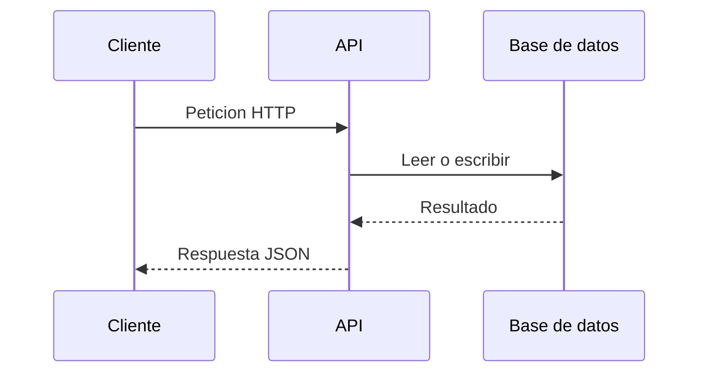
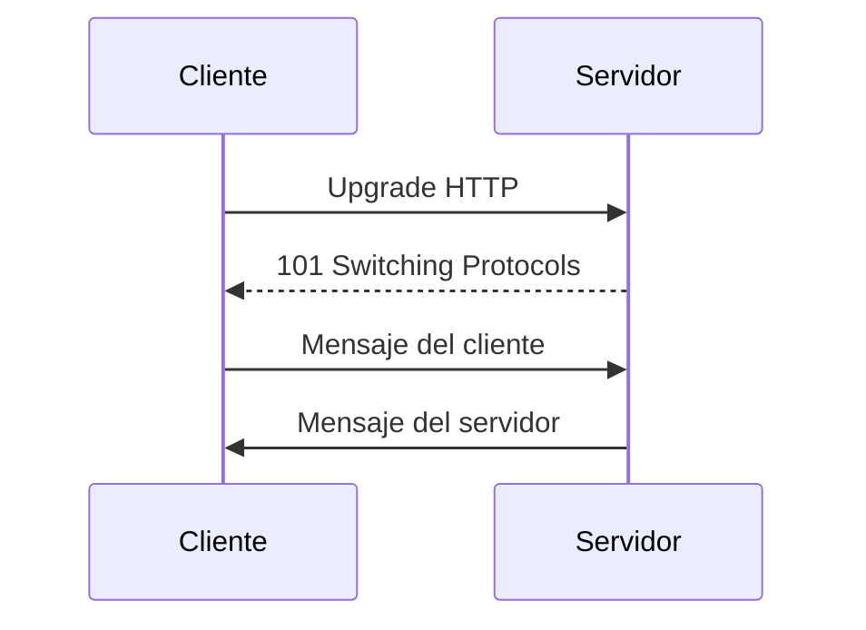

# 03 — APIs

## 1. Qué es una API

**API** (*Application Programming Interface*) = **contrato** entre programas: qué operaciones existen, qué datos enviar y qué esperar de vuelta.

Analogía: la carta de un restaurante — pedir del menú sin entrar a la cocina.

| | UI (interfaz gráfica) | API |
|-|----------------------|-----|
| Para | Personas | Programas |
| Forma | Botones, pantallas | Endpoints, mensajes |

Para qué sirve en la web: separar frontend y backend; varios clientes (web, móvil) sobre el mismo servidor; integrar terceros (pagos, mapas…); exponer datos con control y documentación.

| Elemento | Definición |
|----------|------------|
| **Endpoint** | URL + método HTTP (`GET /productos`) |
| **Request / Response** | Petición / respuesta |
| **Formato** | Casi siempre JSON; también XML, Protocol Buffers… |
| **Autenticación** | Cómo se prueba la identidad (detalle en cap. 05) |
| **Documentación** | OpenAPI/Swagger, Postman, etc. |

Alcance: API **pública**, **privada/partner** o **interna**.  
No confundir: API de una librería en código ≠ **API web** (este curso) ≠ API del sistema operativo.



Buenas prácticas: contrato claro, errores predecibles, versionado (`/v1/...`), HTTPS, documentación al día.

---

## 2. REST y RESTful

**REST** (*Representational State Transfer*, Roy Fielding, 2000) es un **estilo de arquitectura**, no un protocolo y no significa “usar JSON”.

| Término | Significado práctico |
|---------|----------------------|
| **API REST** | API orientada a **recursos** sobre HTTP |
| **RESTful** | API que aplica bien los principios REST |

No hay un sello oficial de “100 % REST”. Muchas APIs llamadas REST son en realidad APIs HTTP+JSON que siguen REST solo en parte.

| Enfoque pobre (acciones en la URL) | Enfoque REST (recurso + método) |
|------------------------------------|----------------------------------|
| `/obtenerUsuario?id=5` | `GET /usuarios/5` |
| `/crearProducto` | `POST /productos` |
| `/eliminarPedido?id=9` | `DELETE /pedidos/9` |

- La **URL** identifica el recurso.
- El **método HTTP** expresa la acción.

Restricciones importantes: cliente-servidor; **stateless**; respuestas cacheables cuando aplique; interfaz uniforme; sistema en capas.  
**HATEOAS** (enlaces a siguientes acciones en la respuesta) forma parte del REST “completo”, pero muchas APIs comerciales no lo usan.

Correspondencia habitual CRUD ↔ HTTP:

| Operación | Método | Ejemplo |
|-----------|--------|---------|
| Create | POST | `POST /productos` |
| Read | GET | `GET /productos` · `GET /productos/42` |
| Update | PUT o PATCH | `PUT /productos/42` · `PATCH /productos/42` |
| Delete | DELETE | `DELETE /productos/42` |

```
GET/POST          /api/v1/productos
GET/PATCH/DELETE  /api/v1/productos/42
GET/POST          /api/v1/productos/42/opiniones
```

REST **no exige** JSON, ni MongoDB, ni “un endpoint por tabla”. Usar HTTP **no** convierte automáticamente una API en REST.

**Casos de uso de REST:**
- CRUD de productos, usuarios, pedidos, cursos…
- API pública documentada para terceros
- Backend de una SPA o app móvil con recursos claros
- Integraciones donde el modelo “recurso + verbo HTTP” encaja bien

---

## 3. Otros estilos (con casos de uso)

REST es el más común en APIs web públicas, pero no el único.

### GraphQL

Lenguaje de consulta: el cliente pide exactamente los campos que necesita. Endpoint típico: `POST /graphql`. Usa HTTP; no lo reemplaza.

**Casos de uso:** pantallas muy distintas (lista vs detalle anidado); apps móviles que quieren poco tráfico; una sola consulta con usuario + pedidos + ítems; reducir *over-fetching* / *under-fetching* de REST.

### SOAP

Mensajes XML con contrato formal (**WSDL**).

**Casos de uso:** banca y pagos con contrato estricto; gobierno/salud con estándares XML; sistemas legacy empresariales; escenarios con WS-Security u operaciones muy formales.

### gRPC

RPC con **Protocol Buffers**, habitualmente sobre HTTP/2. Tipado y eficiente. Existe gRPC-Web para navegadores.

**Casos de uso:** microservicios internos (pedido ↔ inventario ↔ facturación); alta frecuencia y baja latencia dentro del data center; streaming entre servicios; varios lenguajes con el mismo archivo `.proto`.

### WebSockets

Tras un *upgrade* HTTP, canal **persistente y bidireccional**. Suele convivir con REST (CRUD + tiempo real).



**Casos de uso:** chat; documento o tablero colaborativo; juegos en el navegador; paneles en vivo (sensores, colas, cotizaciones).

### SSE (Server-Sent Events)

El servidor **empuja** eventos al cliente por HTTP (`text/event-stream`), en una sola dirección.

**Casos de uso:** aviso de cambio de estado de un pedido; alertas en un panel; progreso de un proceso largo (exportar, procesar); métricas en vivo cuando solo el servidor habla.

### JSON-RPC / XML-RPC

Invocar procedimientos remotos por **nombre de método** (no por recurso REST).

**Casos de uso:** APIs de acciones (`generarFactura`, `calcularRuta`); control de dispositivos; integraciones internas “función + parámetros”; algunos nodos y wallets usan JSON-RPC.

### Webhooks

Se registra una URL; el proveedor envía un `POST` cuando ocurre un evento (notificación saliente).

**Casos de uso:** pasarela de pagos avisa un cobro exitoso; GitHub/GitLab dispara CI tras un `push`; la tienda avisa a logística de un pedido nuevo; notificar a Slack u otro sistema ante un evento.

### Vista rápida

| Estilo | Caso de uso típico |
|--------|--------------------|
| REST | CRUD y APIs públicas de recursos |
| GraphQL | Consultas flexibles y datos anidados |
| SOAP | Enterprise / legacy con WSDL |
| gRPC | Microservicios internos de alto rendimiento |
| WebSockets | Tiempo real bidireccional |
| SSE | Eventos solo servidor → cliente |
| JSON-RPC | Llamar funciones remotas por nombre |
| Webhooks | “Avisar a esta URL cuando pase X” |

---

## Resumen

Una API es un contrato entre programas. **REST** modela recursos sobre HTTP. Otros estilos (GraphQL, SOAP, gRPC, WebSockets, SSE, RPC, webhooks) cubren necesidades distintas; un sistema real suele combinar varios.

## Autoevaluación

1. Definir API y nombrar tres elementos de una API web.
2. Determinar si REST es un protocolo; explicar por qué `/borrarUsuario` no es un diseño REST idiomático.
3. Indicar si GraphQL elimina HTTP; cuándo preferir WebSockets a REST; qué problema típico de REST aborda GraphQL.
