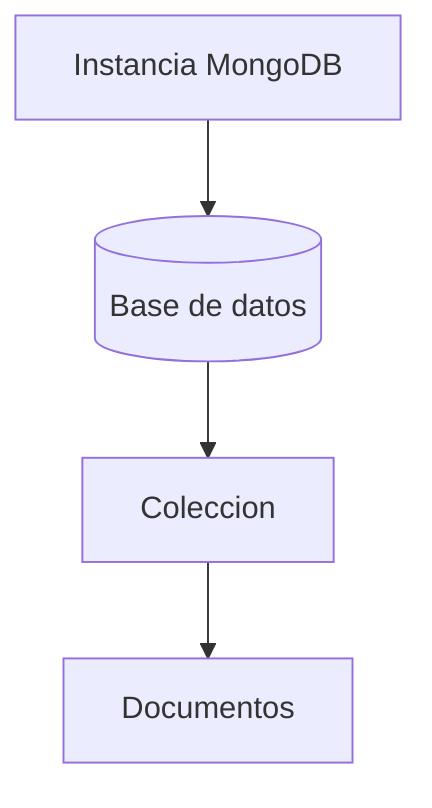
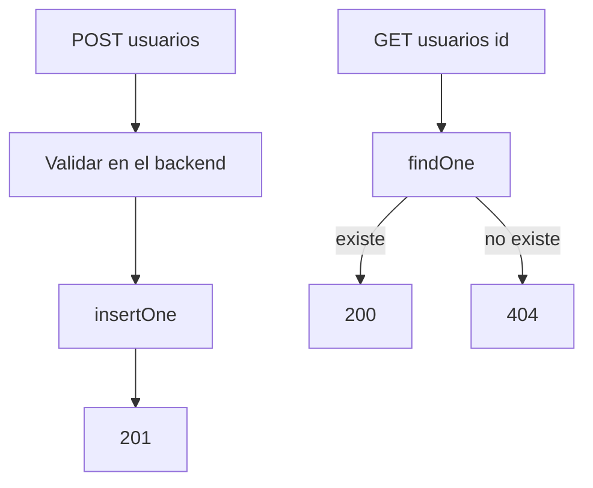

# 04 — MongoDB

## Qué es

**MongoDB** es una base de datos **NoSQL orientada a documentos**. Guarda datos en documentos parecidos a JSON (formato interno: **BSON**, *Binary JSON*), agrupados en **colecciones**.

Es la capa de **persistencia**: la API (cap. 03) lee y escribe aquí. No es un servidor web ni un sistema de autenticación HTTP.

| En una BD relacional | En MongoDB |
|----------------------|------------|
| Tabla | **Colección** |
| Fila | **Documento** |
| Columna | **Campo** |

Ejemplo de documento (en el *shell* de MongoDB el `_id` se muestra como `ObjectId(...)`; en JSON de una API suele ir como texto):

```json
{
  "_id": "65f1c2a9e4b0a1d2c3f45678",
  "nombre": "Ana Pérez",
  "email": "ana@ejemplo.com",
  "roles": ["estudiante"],
  "perfil": { "ciudad": "Medellín" }
}
```

- Todo documento tiene un **`_id`** único (si no se envía, MongoDB lo genera).
- La estructura puede variar entre documentos de la misma colección (*schema flexible*). Eso no significa “sin diseño”: en proyectos reales se define un esquema lógico y se valida (en la app con Mongoose, Zod, etc., o con reglas de validación de MongoDB).



## Operaciones CRUD

| Operación | Métodos habituales |
|-----------|--------------------|
| Create | `insertOne`, `insertMany` |
| Read | `find`, `findOne` |
| Update | `updateOne`, `updateMany`, `replaceOne` |
| Delete | `deleteOne`, `deleteMany` |

```javascript
db.productos.insertOne({ nombre: "Mouse", precio: 45000 })
db.productos.find({ precio: { $lt: 100000 } })
db.productos.updateOne({ _id: id }, { $set: { precio: 39900 } })
db.productos.deleteOne({ _id: id })
```

Operadores frecuentes: comparación (`$eq`, `$gt`, `$lt`, `$in`), actualización (`$set`, `$inc`, `$push`), lógica (`$and`, `$or`).

## Modelado e índices

| Enfoque | Idea | Cuándo conviene |
|---------|------|-----------------|
| **Embebido** | Datos dentro del mismo documento | Se leen siempre juntos y no crecen sin control |
| **Referenciado** | Se guarda el `_id` de otro documento | La entidad se reutiliza o puede crecer mucho |

**Índices:** aceleran búsquedas por campos frecuentes (`email`, `slug`…). Sin índice adecuado, la consulta revisa demasiados documentos.

## Relación con una API REST



MongoDB no “entiende” REST. El **backend** traduce la petición HTTP a operaciones de base de datos.

## Local y Atlas

| Opción | Idea |
|--------|------|
| **Local** | MongoDB Community en la máquina (`mongod`) |
| **Atlas** | MongoDB administrado en la nube |

Los *drivers* oficiales (Node.js, Python, Java…) ofrecen la misma idea de API de programación en ambos casos.

También se puede usar MongoDB con GraphQL, gRPC u otros estilos: la BD no obliga a REST.

## Resumen

MongoDB almacena **documentos** en **colecciones**. El backend hace el CRUD. Modelar bien (embebido vs referencias) e indexar es tan importante como conocer `insert`/`find`/`update`/`delete`.

## Autoevaluación

1. Indicar el análogo de una “fila” en MongoDB.
2. Explicar para qué sirve `_id`.
3. Identificar qué parte del sistema traduce `GET /productos` en un `find`.
