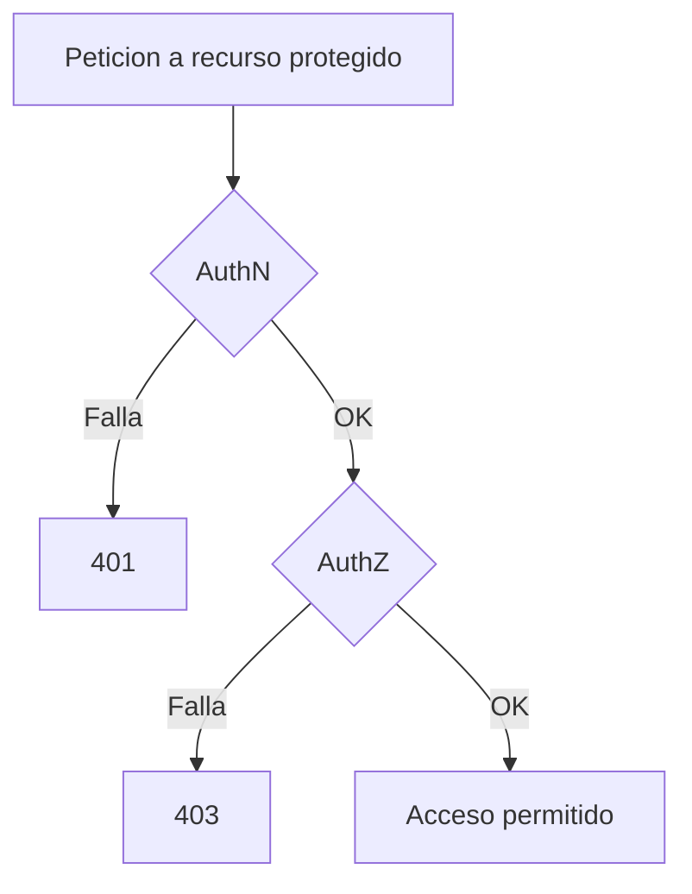
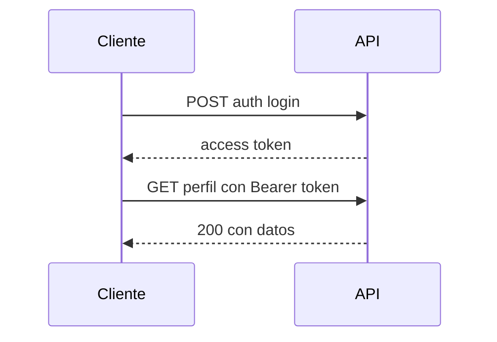

# 05 — Seguridad y autenticación

## AuthN vs AuthZ

Cualquiera puede enviar peticiones a una API pública en Internet. Por eso hace falta protegerla.

| Concepto | Pregunta | Código HTTP relacionado (cap. 02) |
|----------|----------|-----------------------------------|
| **Autenticación (AuthN)** | ¿La identidad es válida? | **401** si falla |
| **Autorización (AuthZ)** | ¿Hay permiso para esta acción? | **403** si falla |

Base de todo: **HTTPS** (cap. 02). Sin cifrado, tokens y contraseñas viajan legibles en la red.

---

## Tipos de autenticación

| Mecanismo | Idea | Caso típico | Cuidado principal |
|-----------|------|-------------|------------------|
| **Sesión + cookie** | Tras el login, el servidor guarda una sesión y envía una cookie | Apps web con navegador | CSRF; marcar cookie `HttpOnly`, `Secure`, `SameSite` |
| **HTTP Basic** | `Authorization: Basic` + usuario:contraseña en Base64 | Casos internos muy simples | Base64 **no** es cifrado; solo con HTTPS |
| **API Key** | Clave secreta que identifica una aplicación | Integraciones servidor a servidor | No publicar la clave en el frontend ni en Git |
| **Bearer / JWT** | Tras el login, un token firmado se envía en cada petición | SPA, móvil, APIs *stateless* | Robo del token, XSS, caducidad (`exp`), revocación |
| **OAuth 2.0** | Autorización **delegada**: acceso sin entregar la contraseña del proveedor | “Continuar con Google”, permisos a terceros | Elegir el flujo correcto; proteger secretos del *client* |
| **OpenID Connect (OIDC)** | Capa de **identidad** sobre OAuth 2.0 (`id_token`) | Login social / SSO moderno | No confundir con OAuth solo (OAuth ≠ login completo por sí solo) |

Roles en OAuth: *resource owner* (usuario), *client* (la app), *authorization server* (emite tokens), *resource server* (la API protegida).

---

## Contraseñas y autorización

1. Nunca almacenar contraseñas en texto plano.
2. Usar *hash* lento con sal: **Argon2id** (preferido hoy), bcrypt o scrypt. Evitar MD5 o SHA-1 “solos” para contraseñas.
3. *Hash* ≠ cifrado: el hash es **unidireccional** (se verifica comparando, no “descifrando”).
4. Limitar intentos (*rate limiting*) y, si aplica, MFA.

Modelos de autorización frecuentes:

| Modelo | Idea |
|--------|------|
| **RBAC** | Permisos por rol (`admin`, `editor`, `estudiante`) |
| **ABAC** | Reglas por atributos (departamento, tipo de recurso…) |
| **Ownership** | Solo quien “dueña” el recurso puede modificarlo |

No basta con “estar logueado”: comprobar permiso sobre el recurso concreto (`DELETE /pedidos/55` solo si corresponde).

---

## Amenazas básicas (solo prevención)

| Amenaza | Idea | Defensa esencial |
|---------|------|------------------|
| **XSS** | Script malicioso en contenido web | Escapar/sanitizar salida; CSP |
| **CSRF** | Usar la sesión del navegador para una acción no deseada | `SameSite`; tokens CSRF |
| **Inyección** | Datos que alteran consultas SQL/NoSQL | APIs del *driver* / consultas seguras; validar entrada |
| **Broken access control** | Acceder a datos de otra persona cambiando un id | AuthZ en el servidor por recurso |
| **Secrets filtrados** | Claves en Git, frontend o logs | Variables de entorno / gestores de secretos |
| **MITM** | Interceptar tráfico en red insegura | HTTPS |
| **Fuerza bruta** | Probar muchas contraseñas o saturar la API | *Rate limiting*, MFA |

**CORS** es una política del **navegador** sobre peticiones entre orígenes distintos. No sustituye autenticación ni protege la API frente a Postman, curl u otro servidor.

Otras prácticas útiles: HSTS; validación siempre en servidor; mínimo privilegio en tokens y roles; no devolver *stack traces* en errores 500.

Sobre la BD (cap. 04): usuario de MongoDB con privilegios mínimos; no exponer la base de datos a Internet sin control.

---

## Resumen

Seguridad web = **HTTPS** + **autenticación** + **autorización** + **validación** + buen manejo de secretos. El mecanismo (cookie, JWT, API key, OAuth/OIDC) depende del tipo de cliente.

## Autoevaluación

1. Diferenciar AuthN y AuthZ; relacionar con 401 y 403.
2. Explicar por qué Base64 en Basic Auth no es cifrado; diferenciar OAuth 2.0 y OIDC.
3. Indicar qué no cubre CORS y dónde debe validarse el permiso para borrar el pedido 55.
