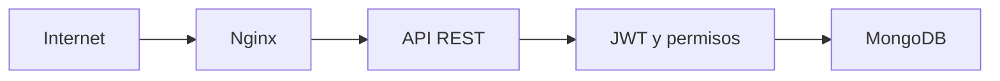
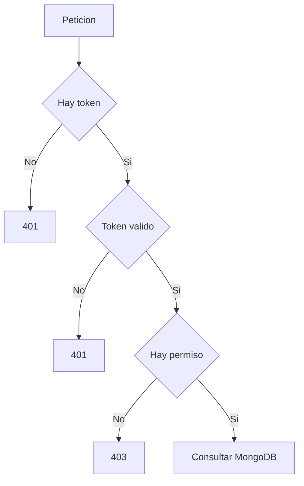

# 06 — Anexos

## 1. Ejemplo integrado

Consulta de un libro en una API de biblioteca.

```
https://api.biblioteca.edu/v1/libros/108
```

```http
GET /v1/libros/108 HTTP/1.1
Host: api.biblioteca.edu
Accept: application/json
Authorization: Bearer <token>
```





| Resultado | Código |
|-----------|--------|
| Libro encontrado | `200` + JSON |
| No existe | `404` |
| Sin autenticación | `401` |
| Sin permiso | `403` |

Crear libro: `POST /v1/libros` con Bearer → autenticar → autorizar → validar body → `insertOne` → `201`.

| Paso | Tema | Cap. |
|------|------|------|
| URL | URI / URL | 01 |
| Cliente pide / servidor responde | Arquitectura | 01 |
| GET, headers, status | HTTP | 02 |
| Nginx | Servidor web | 02 |
| `/v1/libros/108` | API REST | 03 |
| `findOne` / `insertOne` | MongoDB | 04 |
| JWT, 401, 403 | Seguridad | 05 |

---

## 2. Glosario

| Término | Definición breve |
|---------|------------------|
| API | Contrato entre programas |
| API Key | Secreto que identifica una aplicación |
| AuthN / AuthZ | Verificar identidad / verificar permisos |
| Backend / Frontend | Servidor / interfaz de usuario |
| BSON | Formato binario de documentos de MongoDB |
| Cliente / Servidor | Quien inicia la petición / quien responde |
| 1 / 2 / 3 / n-tier | App en 1 capa, cliente+BD, presentación+lógica+datos, o más capas |
| Colección / Documento | Grupo de documentos / un registro en MongoDB |
| CORS | Restricción del navegador entre orígenes distintos |
| CRUD | Create, Read, Update, Delete |
| CSRF / XSS | Abuso de la sesión del navegador / inyección de script |
| CSP | Política que limita scripts y recursos de la página |
| DNS | Traducción de nombre de dominio a IP |
| Endpoint | Ruta + método de una API |
| GraphQL / gRPC / SOAP | Alternativas o complementos a REST |
| Hash (contraseña) | Transformación unidireccional para almacenar secretos |
| HTTP / HTTPS | Protocolo web / HTTP protegido con TLS |
| Idempotente | Repetir la operación no cambia el resultado final |
| JSON / JWT | Formato de datos / token firmado |
| MongoDB / NoSQL | BD de documentos / familias no relacionales |
| OAuth 2.0 / OIDC | Autorización delegada / identidad sobre OAuth |
| Rate limiting / RBAC | Límite de peticiones / permisos por roles |
| REST / RESTful | Estilo orientado a recursos / aplicación rigurosa de REST |
| Reverse proxy | Servidor que reenvía HTTP hacia la aplicación |
| Stateless | Cada petición se basta a sí misma (a nivel de protocolo) |
| Status code | Código de resultado HTTP |
| TLS | Capa criptográfica bajo HTTPS |
| URI / URL / URN | Identificar / localizar / nombrar un recurso |
| Webhook / WebSocket | Aviso HTTP de un evento / canal bidireccional persistente |

> Con **URL** y **HTTPS**, el **cliente** habla con una **API** (a menudo **REST**); el **servidor** **autentica y autoriza**, consulta **MongoDB** si hace falta y responde con un **status** y datos.
