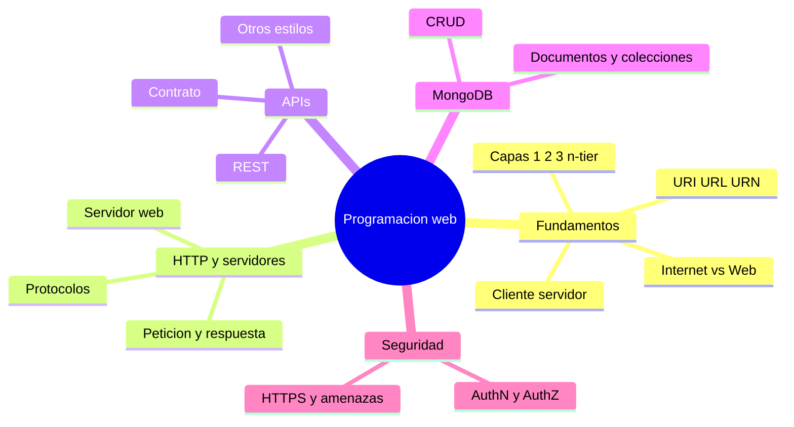
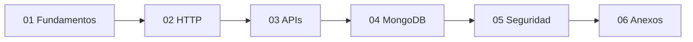
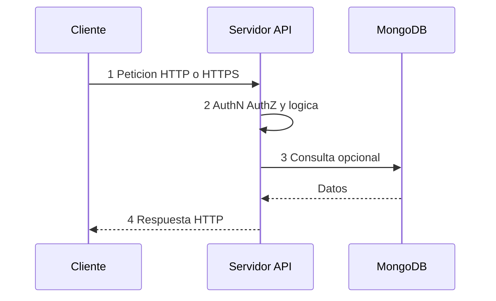

  

# Programación Web — Resumen de conceptos importantes

Institución Universitaria Pascual Bravo

## Mapa y orden de estudio

## Flujo de una petición

## Capítulos

| # | Archivo | Contenido |
|---|---------|-----------|
| 01 | [Fundamentos web](./01-fundamentos-web.md) | Internet vs Web, URI/URL, cliente-servidor, 1/2/3/n-tier |
| 02 | [HTTP, protocolos y servidores](./02-http-protocolos-y-servidores.md) | Protocolos, peticiones, respuestas, servidores web |
| 03 | [APIs](./03-apis.md) | Qué es una API, REST/RESTful, otros estilos y casos de uso |
| 04 | [MongoDB](./04-mongodb.md) | Documentos, colecciones, CRUD, modelado |
| 05 | [Seguridad](./05-seguridad.md) | AuthN/AuthZ, tipos de autenticación, amenazas básicas |
| 06 | [Anexos](./06-anexos.md) | Ejemplo integrado y glosario |
